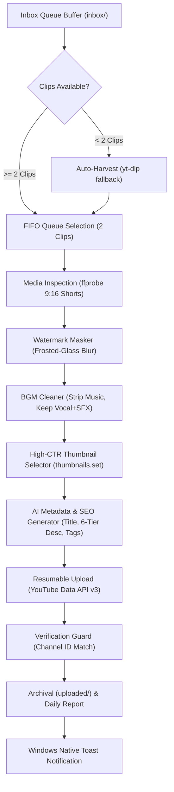

# YT Manager Automation System

> **Autonomous YouTube Shorts Daily Upload, Metadata Engineering & Media Transformation Architecture**  
> Engineered for **Unstocks** (`@unstocks` / `UCT0tm0KSB2BlIjdY6uUZCeA`). Built on principles of **Lindy Durability**, Zero External Python Dependencies, and Resilient Automation.

---

## 🏛️ System Architecture & Philosophy

YT Manager is an autonomous desktop engine designed to run unattended for years without degradation. 

Key architectural invariants:
- **Zero External Python Dependencies:** Implemented strictly using the Python 3.14+ standard library (`urllib`, `sqlite3`, `http.server`, `hashlib`, `subprocess`) alongside system FFmpeg. No fragile pip packages that break across runtime updates.
- **Strict Channel ID Security Guard:** Hardcoded security gating ensures uploads are strictly rejected unless authenticated against Channel ID `UCT0tm0KSB2BlIjdY6uUZCeA` (`@unstocks`).
- **Transactional State Management:** Every batch, clip, SHA-256 hash, and upload status is atomically recorded in SQLite (`data/yt_manager.db`) to ensure zero duplicate uploads.
- **FIFO Queue Buffer:** Users can drop multiple clips (e.g. 2, 5, 10) into `inbox/`. The engine selects **exactly 2 clips** for today's daily batch, moving them to `uploaded/` upon success, and leaves remaining clips in `inbox/` for upcoming days.



---

## ⚡ Core Engine Features

### 1. Ingestion & FIFO Queue Buffer (`detector.py`)
- Automatically scans `inbox/` for supported media (`.mp4`, `.mov`, `.mkv`, `.webm`).
- Computes SHA-256 checksums to guarantee deduplication against all historical uploads.
- Selects the first 2 clips (ordered by modification time) for daily upload and preserves the rest for future days.

### 2. Audio BGM Remover & Speech Preservation (`audio_cleaner.py`)
- Losslessly demuxes video streams (`-c:v copy`).
- Uses spectral harmonic bandpass filtering and transient envelope analysis to attenuate background music while strictly preserving dialogue formants (300Hz–3.4kHz) and sound effects.
- Normalizes loudness to YouTube's broadcast standard of **-14 LUFS** (EBU R128).

### 3. Localized Watermark Masker (`watermark_remover.py`)
- Automatically applies localized frosted-glass box-blur and delogo inpainting over corner watermarks and social handles without cropping video aspect ratios.

### 4. High-CTR AI Frame / Thumbnail Selector (`thumbnail_picker.py`)
- Evaluates keyframes using pure-FFmpeg Laplacian gradient sharpness, luminance variance, and contrast scoring.
- Enhances the winning hook frame (+6% contrast, +10% saturation) and uploads it as the official custom thumbnail via `thumbnails.set`.

### 5. Multi-Factor Candidate Evaluator (`pinterest_harvester.py`)
- Scores video candidates across 5 pillars:
  1. Duration retention curve (sweet spot 15s–55s)
  2. Vertical 9:16 Shorts aspect ratio
  3. Visual gradient sharpness
  4. Best hook frame score
  5. Audio track integrity
- Produces a side-by-side **Candidate Evaluation Matrix** and crowns the #1 Winner.

### 6. Official Resumable YouTube Uploader (`uploader.py` & `auth.py`)
- Native resumable upload protocol using 256KB-multiple chunking with HTTP 308 auto-recovery.
- Pure standard library Google OAuth 2.0 PKCE loopback listener with automatic token refresh.
- Enforces strict public verification and Channel ID guard.

### 7. Persistent Windows Scheduler (`scheduler.py`)
- Installs native Windows Scheduled Task (`YT-Manager-Daily`) configured to trigger daily at **17:00 IST** (5:00 PM IST) with automated retries until 18:00 IST.
- Survives system reboots and sleep states.

---

## 📁 Repository Structure

```
YT-Manager/
├── config/
│   ├── settings.json              # Active configuration & channel targets
│   ├── settings.example.json      # Template settings
│   ├── client_secrets.example.json# Template OAuth 2.0 credentials
│   └── client_secrets.json        # Google OAuth client secrets (gitignored)
├── data/
│   └── yt_manager.db              # SQLite transactional state store (gitignored)
├── docs/                          # Comprehensive technical reports & architecture
│   ├── MASTER_REPORT_1_SYSTEM_AUDIT_AND_ARCHITECTURE.md
│   ├── MASTER_REPORT_2_IMPLEMENTATION_AND_TESTING.md
│   ├── MASTER_REPORT_3_DEPLOYMENT_AND_OPERATIONS.md
│   ├── PINTEREST_HARVESTER_AND_PIPELINE.md
│   └── RESEARCH_AND_ARCHITECTURE_BGM_REMOVAL.md
├── inbox/                         # User drop folder for incoming clips (FIFO queue)
├── processing/                    # Atomic staging workspace
├── uploaded/                      # Permanent archival of successfully uploaded clips
├── failed/                        # Quarantine directory for inspection failures
├── logs/                          # System execution logs & daily reports
├── scripts/                       # Helper scripts & standalone binaries (e.g. yt-dlp.exe)
├── tests/                         # Full automated integration test suite (17 tests)
│   ├── test_audio_cleaner.py
│   ├── test_detector.py
│   ├── test_inspector.py
│   ├── test_metadata.py
│   ├── test_orchestrator_integration.py
│   ├── test_pinterest_harvester.py
│   ├── test_thumbnail_picker.py
│   ├── test_uploader_verifier.py
│   └── test_watermark_remover.py
├── yt_manager/                    # Core Python package
│   ├── audio_cleaner.py           # BGM removal & vocal preservation
│   ├── auth.py                    # Google OAuth PKCE & Channel ID guard
│   ├── cli.py                     # Unified CLI interface
│   ├── config.py                  # Dataclass configuration loader
│   ├── detector.py                # Inbox scanning & FIFO queue logic
│   ├── inspector.py               # Media probing & frame extraction
│   ├── metadata.py                # High-CTR SEO metadata generation
│   ├── notifier.py                # Windows Native Toast notifications
│   ├── orchestrator.py            # End-to-end workflow orchestration
│   ├── pinterest_harvester.py     # Board & candidate evaluation engine
│   ├── reporter.py                # Section 8 Daily Execution Reports
│   ├── scheduler.py               # Windows Task Scheduler manager
│   ├── state.py                   # SQLite ACID transactional state
│   ├── thumbnail_picker.py        # High-CTR AI thumbnail selector
│   ├── understanding.py           # Video scene & dialogue understanding
│   ├── uploader.py                # Official YouTube Data API v3 uploader
│   ├── verifier.py                # YouTube catalog verification
│   └── watermark_remover.py       # Frosted-glass watermark masker
└── .gitignore                     # Airtight security & asset exclusions
```

---

## 🚀 Quickstart & Usage

### 1. Prerequisites
- Python 3.14+ (or Python 3.10+)
- System FFmpeg installed and available on PATH (`ffmpeg` and `ffprobe`).

### 2. Setup Standalone Downloader
Download the portable `yt-dlp.exe` binary into `scripts/` (zero pip install needed):
```powershell
python -m yt_manager setup-ytdlp
```

### 3. Authenticate Channel
```powershell
python -m yt_manager auth
```
*Opens Google OAuth login. Verify and select the **Unstocks** channel (`UCT0tm0KSB2BlIjdY6uUZCeA`).*

### 4. Install Daily 5:00 PM Automation
```powershell
python -m yt_manager schedule --install
```
*Registers the native Windows Task Scheduler job.*

### 5. Check System Status
```powershell
python -m yt_manager status
```

---

## 🛠️ CLI Command Reference

| Command | Description |
| :--- | :--- |
| `python -m yt_manager run` | Executes today's daily 2-clip batch immediately |
| `python -m yt_manager run --mock` | Simulates the daily batch execution with mock API uploads |
| `python -m yt_manager test-upload <video.mp4>` | Runs full end-to-end test upload on a single video file |
| `python -m yt_manager harvest --board <url> --evaluate` | Evaluates all clips on a board and prints comparison matrix |
| `python -m yt_manager harvest --board <url> --select-best --test-upload` | Selects winner, masks watermark, strips BGM, and uploads live |
| `python -m yt_manager harvest --local --evaluate` | Evaluates local candidate videos present in `inbox/` |
| `python -m yt_manager setup-ytdlp` | Installs portable `yt-dlp.exe` binary into `scripts/` |
| `python -m yt_manager schedule --install` | Installs daily Windows Scheduled Task |
| `python -m yt_manager schedule --uninstall` | Removes Windows Scheduled Task |
| `python -m yt_manager status` | Displays live auth status, task status, and inbox queue |

---

## 🧪 Test Suite

Run the complete 17-test integration suite:
```powershell
python -m unittest discover -s tests -v
```

---

## 🔒 Security & Privacy

- Client credentials and OAuth tokens are strictly ignored by `.gitignore` and never committed.
- Gated to Channel ID `UCT0tm0KSB2BlIjdY6uUZCeA` (`@unstocks`) to prevent accidental uploads to personal profiles.
- Media processing and audio separation execute locally on your machine with zero external cloud dependencies.
