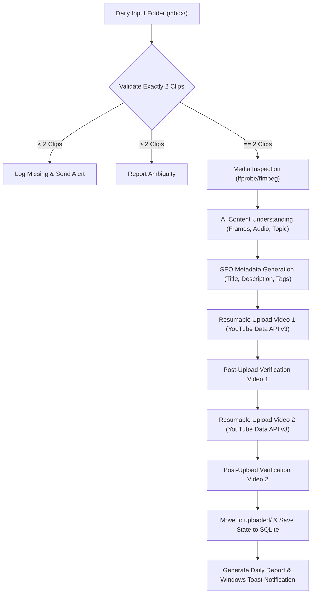

# YT Manager Automation System

> **Autonomous YouTube Metadata Engineering & Daily Upload Automation**  
> Engineered for **Unstocks** (`@unstocks` / `UCT0tm0KSB2BlIjdY6uUZCeA`). Built on principles of **Lindy Durability**, Zero External Python Dependencies, and Resilient Automation.

---

## 🏛️ System Architecture & Philosophy

YT Manager is an autonomous desktop engine designed to manage daily YouTube video uploads for Unstocks at **6:00 PM IST (Asia/Kolkata)**.

The user provides **exactly two video clips** daily into `YT-Manager/inbox/`. YT Manager detects the clips, performs deep content understanding, crafts SEO-optimized titles, descriptions, tags, and hashtags, uploads both videos directly to the specified YouTube channel via the official YouTube Data API v3, verifies their public catalog registration, and records execution status.

### Key Architectural Invariants
- **Zero External Python Dependencies:** Implemented strictly using the Python 3.14+ standard library (`urllib`, `sqlite3`, `http.server`, `hashlib`, `subprocess`) alongside system FFmpeg. No fragile pip packages that break across runtime updates.
- **Strict Channel ID Security Guard:** Hardcoded security gating ensures uploads are strictly rejected unless authenticated against Channel ID `UCT0tm0KSB2BlIjdY6uUZCeA` (`@unstocks`).
- **Transactional State Management:** Every batch, clip, SHA-256 hash, and upload status is atomically recorded in SQLite (`data/yt_manager.db`) to ensure zero duplicate uploads.
- **Strict 2-Clip Daily Rule:** Validates that exactly 2 valid, un-uploaded clips exist in `inbox/`. Rejects partial batches (<2) with desktop alerts; detects ambiguity if excess clips exist.
- **Zero Video Alteration:** The original video content is never modified, edited, or re-encoded. Videos are uploaded exactly as prepared by the creator.



---

## ⚡ Core Modules

### 1. Ingestion & Gatekeeper (`yt_manager/detector.py`)
- Scans `inbox/` for supported media (`.mp4`, `.mov`, `.mkv`, `.webm`, `.avi`, `.m4v`).
- Computes SHA-256 checksums to guarantee deduplication against all historical uploads.
- Validates that exactly 2 valid, un-uploaded clips are staged for today's batch.

### 2. Media Inspector (`yt_manager/inspector.py`)
- Uses `ffprobe` to extract resolution, aspect ratio, duration, codecs, FPS, and bitrate.
- Detects YouTube Shorts formatting (aspect ratio ≤ 1.05 and duration ≤ 60s).
- Extracts keyframe samples and audio stream for content analysis.

### 3. AI Video Understanding Engine (`yt_manager/understanding.py`)
- Analyzes actual video content across keyframes, on-screen text, audio, and visual themes.
- Enforces the **Critical Accuracy Rule**: never invents facts, quotes, or statistics not established in the clip.
- Supports sidecar context files (`<clip_name>.json` or `<clip_name>.txt`), multimodal Gemini Vision API, and deterministic content-grounded inspection.

### 4. SEO Metadata Generator (`yt_manager/metadata.py`)
- Independently generates for each clip:
  - **Title**: High-CTR, search-optimized, strong opening keywords, no clickbait, concise (<80 chars), with `#Shorts` for vertical clips. Exactly 1 recommended title.
  - **Description**: 6-tier structured description (compelling opening hook, concise explanation, naturally incorporated search keywords, additional context, Unstocks CTA, and relevant hashtags).
  - **Tags**: Niche search keywords and entities strictly under 500 characters.
  - **Category & Language**: Dynamic assignment (e.g. Science & Tech `28`, Education `27`, Language `en`).
- Serializes complete metadata to `metadata/<clip_id>.json`.

### 5. Official YouTube Resumable Uploader (`yt_manager/uploader.py` & `auth.py`)
- Official YouTube Data API v3 resumable chunked protocol (256 KB multiples).
- Automatic recovery via HTTP 308 queries on dropped network connections with exponential backoff.
- Mandatory Channel ID check against `UCT0tm0KSB2BlIjdY6uUZCeA` before uploading.

### 6. Post-Upload Verifier (`yt_manager/verifier.py`)
- Polls YouTube API to verify catalog entry, processing status, and public accessibility.
- Captures exact rejection reasons if a video is restricted or rejected.

### 7. Persistent Scheduler (`yt_manager/scheduler.py`)
- Windows Task Scheduler integration (`scripts/install_scheduler.ps1`): Triggers daily at 6:00 PM IST (18:00 Asia/Kolkata).
- Standalone background daemon mode with automatic retry intervals if clips are incomplete.

---

## 📁 Repository Structure

```
YT-Manager/
├── config/
│   ├── settings.json              # Active configuration & channel targets
│   ├── settings.example.json      # Template settings
│   ├── client_secrets.example.json# Template OAuth 2.0 credentials
│   ├── client_secrets.json        # Google OAuth client secrets (gitignored)
│   └── token.json                 # Persistent OAuth token store (gitignored)
├── data/
│   └── yt_manager.db              # SQLite transactional state store (gitignored)
├── docs/                          # Master Reports
│   ├── MASTER_REPORT_1_SYSTEM_AUDIT_AND_ARCHITECTURE.md
│   ├── MASTER_REPORT_2_IMPLEMENTATION_AND_TESTING.md
│   └── MASTER_REPORT_3_DEPLOYMENT_AND_OPERATIONS.md
├── inbox/                         # User drop folder for daily 2 video clips
├── processing/                    # Atomic staging workspace
├── uploaded/                      # Permanent archival of successfully uploaded clips
├── failed/                        # Quarantine directory for inspection failures
├── logs/                          # System execution logs & daily reports
│   ├── yt_manager.log
│   └── reports/
├── metadata/                      # Generated clip metadata JSON documents
├── scripts/                       # Helper scripts (install_scheduler.ps1, run_daily.ps1)
├── tests/                         # Automated test suite (18 unit/integration tests)
└── yt_manager/                    # Pure Python core engine
    ├── __init__.py
    ├── __main__.py
    ├── auth.py
    ├── cli.py
    ├── config.py
    ├── detector.py
    ├── inspector.py
    ├── metadata.py
    ├── notifier.py
    ├── orchestrator.py
    ├── reporter.py
    ├── scheduler.py
    ├── state.py
    ├── understanding.py
    ├── uploader.py
    └── verifier.py
```

---

## 🚀 Quick Start

### 1. Authenticate YouTube Account (One-Time)
```powershell
python -m yt_manager auth
```

### 2. Verify Status
```powershell
python -m yt_manager status
```

### 3. Place 2 Clips in Inbox
Drop your two daily video files (e.g. `clip_01.mp4` and `clip_02.mp4`) into:
```
C:\Users\sanja\.gemini\antigravity\scratch\YT-Manager\inbox\
```

### 4. Run Batch Manually or Test in Mock Mode
```powershell
# Run in mock mode (dry run)
python -m yt_manager run --mock

# Run live production upload
python -m yt_manager run
```

### 5. Install Persistent Windows Daily Scheduler (6:00 PM IST)
```powershell
powershell -ExecutionPolicy Bypass -File .\scripts\install_scheduler.ps1
# OR
python -m yt_manager schedule --install
```
