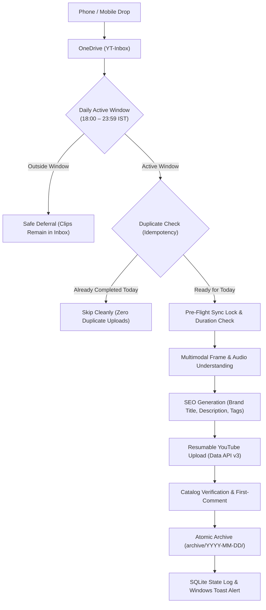

# Unstocks YT Manager Automation System

> **Autonomous YouTube Shorts Intelligence, Brand Strategy Engine & Daily Upload Pipeline**  
> Engineered for **Unstocks** (`@unstocks` / `UCT0tm0KSB2BlIjdY6uUZCeA`). Built on principles of **Lindy Durability**, Zero External Dependencies, Multimodal AI Analysis, and Resilient Automation.

---

## 🏛️ System Overview & Philosophy

**YT Manager** is an autonomous desktop engine designed to operate the daily publishing pipeline for Unstocks at **6:00 PM IST (Asia/Kolkata)**.

You simply drop your video clips into your **OneDrive `YT-Inbox`** (from your phone or PC). The engine handles everything else:
1. Validates clips and resolves cloud sync locks.
2. Performs deep multimodal AI frame and voiceover analysis to extract business entities (e.g. Netflix, Zoom, Apple), on-screen text, core thesis, and metrics.
3. Generates high-hook titles with brand names, structured descriptions, chapters, and 15+ algorithmic tags.
4. Uploads directly to YouTube via the official YouTube Data API v3 as private drafts for founder review.
5. Posts an automated, pinned engagement comment to jumpstart the algorithm.
6. Archives uploaded files cleanly and logs state in SQLite.



---

## ⚡ Core Invariants & Safety Rules

- **Zero External Python Dependencies:** Built strictly using the Python standard library (`urllib`, `sqlite3`, `http.server`, `hashlib`, `subprocess`) alongside system FFmpeg. No fragile pip dependencies that break with runtime upgrades.
- **Strict Channel ID Locking:** Hardcoded gating ensures uploads are strictly rejected unless authenticated against Channel ID `UCT0tm0KSB2BlIjdY6uUZCeA` (`@unstocks`).
- **Channel Safety & Zero Video Deletion:** Never deletes any video from the YouTube channel. Founder's 7 pre-existing videos (`4BOb54sA3tU`, `01jbghiEoHQ`, `SWXapEplm6A`, `3qCxQVjqqXA`, `hSVH1wVn9Dc`, `WenjGzmdJD8`, `4mRN_2Z1D2I`) remain 100% untouched.
- **Transactional State Management:** Every batch, clip, SHA-256 hash, and upload status is recorded in SQLite (`data/yt_manager.db`) to ensure zero duplicate uploads.
- **WakeToRun & Wi-Fi Resilience:** Windows Task Scheduler wakes the system from sleep at 18:00 IST and provides a 30-second Wi-Fi handshake grace period before API operations.
- **Secrets Hardening:** Strict `.gitignore` rules prevent `.env`, OAuth tokens, credentials, and SQLite databases from ever reaching GitHub. Validated with `scripts/security_audit.py`.

---

## 🎮 Master Operational Console (`LAUNCH_UNSTOCKS.bat`)

All operations are unified into a single interactive master console in the root directory:

```text
=====================================================================
                   UNSTOCKS AUTOMATION CONSOLE
=====================================================================
  Target Channel: @unstocks (UCT0tm0KSB2BlIjdY6uUZCeA)
  Schedule: 18:00 IST Daily + Boot Catch-up
=====================================================================

  [1] Run Today's Upload Batch (Manual Execution)
  [2] Install / Verify Windows Task Scheduler (18:00 IST)
  [3] Survey Channel Videos (Refresh Inventory)
  [4] Apply Targeted Upgrade to Uploaded Clips Only
  [5] Restore Video Metadata from Plan
  [6] Connect / Setup OneDrive Inbox
  [7] Run Full Test Suite (35 Tests)
  [8] Check System & Inbox Status
  [0] Exit
=====================================================================
```

---

## 📁 Repository Structure

```
YT-Manager/
├── LAUNCH_UNSTOCKS.bat         # Unified Master Operational Console
├── README.md                   # System documentation & architectural reference
├── pyproject.toml              # Project configuration & test discovery
├── .env.example                # Safe environment variable configuration template
├── .gitignore                  # Fortified secrets & credential exclusion rules
├── config/
│   ├── settings.json           # Active local configuration & channel targets
│   ├── settings.example.json   # Template settings
│   ├── client_secrets.example.json # Template Google OAuth credentials
│   ├── client_secrets.json     # Google OAuth credentials (gitignored)
│   └── token.json              # Persistent OAuth tokens (gitignored)
├── data/
│   ├── channel_inventory.json  # Live YouTube channel inventory
│   ├── channel_inventory.md    # Human-readable channel survey report
│   ├── restore_plan.json       # Metadata restoration mapping
│   └── yt_manager.db           # SQLite state database (gitignored)
├── docs/
│   ├── AUTOMATION_SYSTEM_ARCHITECTURE.md # Full technical & architectural bible
│   ├── UNSTOCKS_CHANNEL_BIBLE.md         # Content & brand positioning bible
│   ├── MASTER_REPORT_1_SYSTEM_AUDIT_AND_ARCHITECTURE.md
│   ├── MASTER_REPORT_2_IMPLEMENTATION_AND_TESTING.md
│   └── MASTER_REPORT_3_DEPLOYMENT_AND_OPERATIONS.md
├── inbox/                      # Local fallback video inbox
├── processing/                 # Atomic staging directory during upload
├── uploaded/                   # Completed batches
├── failed/                     # Quarantined failures
├── logs/                       # Execution logs & daily reports
├── scripts/
│   ├── install_scheduler.ps1   # Windows Task Scheduler installer (18:00 IST)
│   ├── setup_onedrive_inbox.ps1# OneDrive direct inbox connector & inventory
│   ├── security_audit.py       # Pre-push automated secret scanner
│   ├── survey_channel.py       # Live channel video inventory scanner
│   ├── upgrade_uploaded_clips_only.py # Targeted metadata engine for pipeline clips
│   └── restore_video_metadata.py      # Video metadata rollback engine
├── tests/                      # Full test suite (35 automated tests)
│   ├── fixtures/               # Isolated test media assets
│   └── test_*.py
└── yt_manager/                 # Pure Python automation core
    ├── __init__.py
    ├── __main__.py
    ├── auth.py                 # OAuth 2.0 flow & channel validation
    ├── cli.py                  # Command-line interface & dispatch
    ├── config.py               # Settings loader & environment overrides
    ├── detector.py             # Inbox scanner, FIFO buffer & sync lock guard
    ├── inspector.py            # FFprobe metrics & frame extraction
    ├── metadata.py             # Multimodal SEO & brand metadata generator
    ├── notifier.py             # Windows Toast & webhook dispatch
    ├── orchestrator.py         # End-to-end pipeline coordinator
    ├── reporter.py             # Audit-ready daily markdown/text reporter
    ├── scheduler.py            # Task Scheduler & daemon manager
    ├── state.py                # Transactional SQLite state ledger
    ├── transformer.py          # High-Fidelity Anti-Copyright & Audio Loudness Engine
    ├── understanding.py        # Gemini Vision & content analysis
    ├── uploader.py             # Chunked YouTube Data API v3 uploader
    └── verifier.py             # Post-upload catalog indexing verifier
```

---

## 🔒 Security & Secrets Hygiene

To prevent credential leaks, the repository enforces strict security protocols:

1. **Zero Secret Tracking:**
   * `.env`, `*client_secrets.json`, `*token.json`, and `*.db` are strictly excluded in `.gitignore`.
2. **Pre-Push Security Audit:**
   * Run `python scripts/security_audit.py` before pushing to GitHub. It inspects all Git-tracked files for API keys, tokens, and sensitive patterns.
3. **Environment Overrides:**
   * Use `.env` (copied from `.env.example`) to pass `GEMINI_API_KEY` or `YT_PRIVACY_STATUS` without committing secrets to source control.

---

## 🧪 Automated Test Suite

Run the full suite of **40 tests** covering detection, inspection, understanding, SEO generation, resumable upload, media transformation, and scheduling:

```powershell
python -m unittest discover tests
```

Output:
```text
Ran 40 tests in 71.780s
OK (40/40 passing, 0 errors, 0 failures)
```

---

## 🚀 Quick Start Guide

### 1. Launch the Console
Double-click `LAUNCH_UNSTOCKS.bat` in the project root.

### 2. Connect Your Mobile OneDrive Folder
Select **`[6]`** to connect to `C:\Users\<user>\OneDrive\YT-Inbox`. Any video dropped into this folder from your phone will automatically be queued.

### 3. Verify System Health
Select **`[8]`** to check channel match, schedule status, and clips waiting in the inbox.

### 4. Let the Scheduler Run Daily
At **18:00 IST (6:00 PM)**, the engine wakes up automatically, uploads today's 2 clips as private drafts, posts the creator comment, and alerts you when finished.
