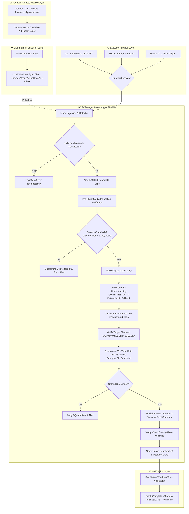
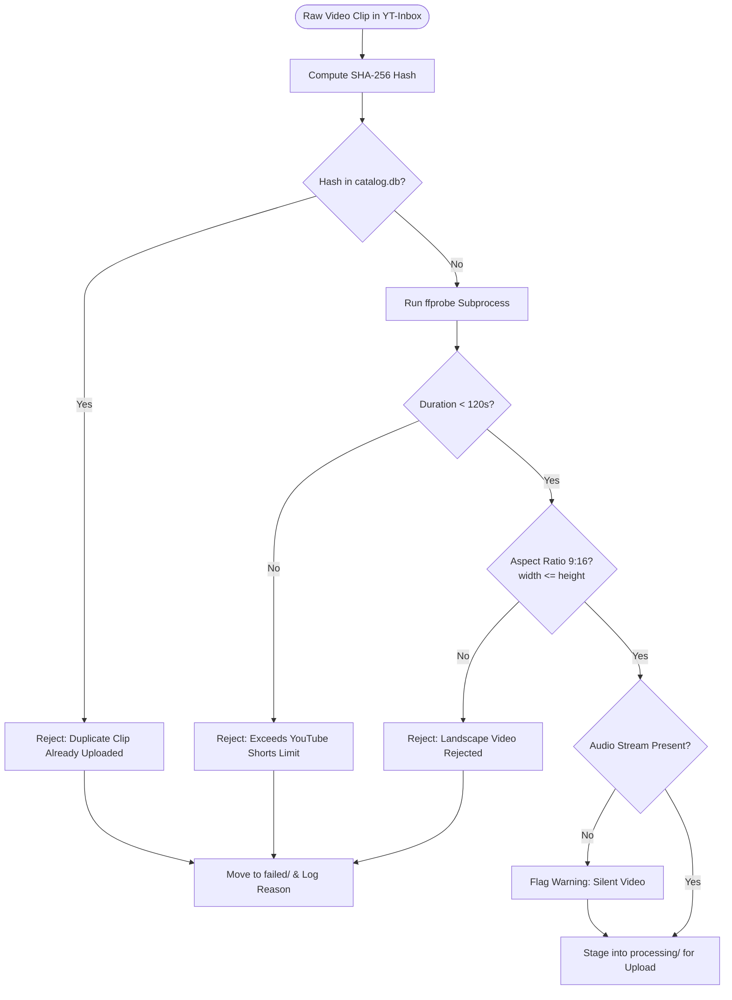
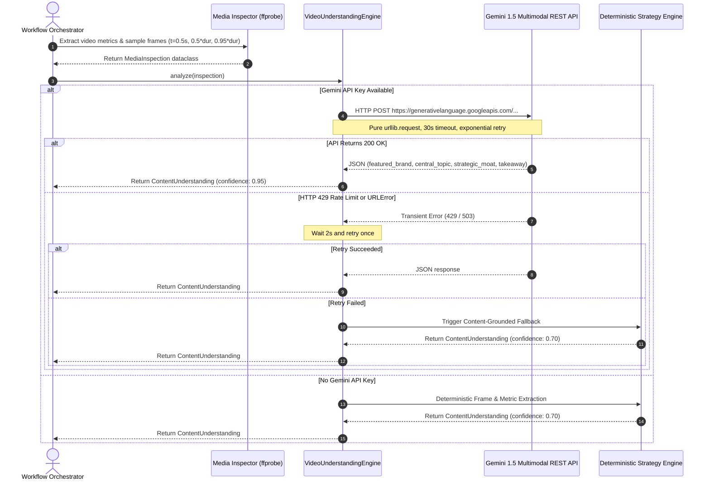
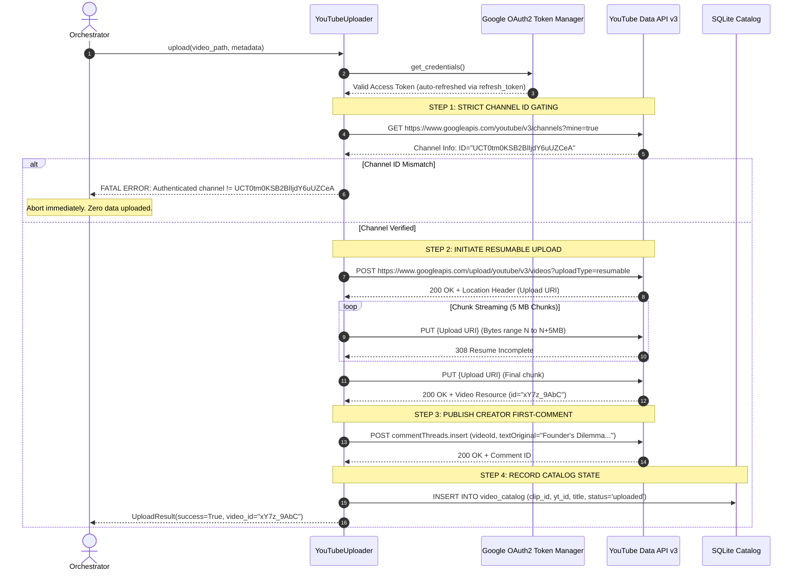
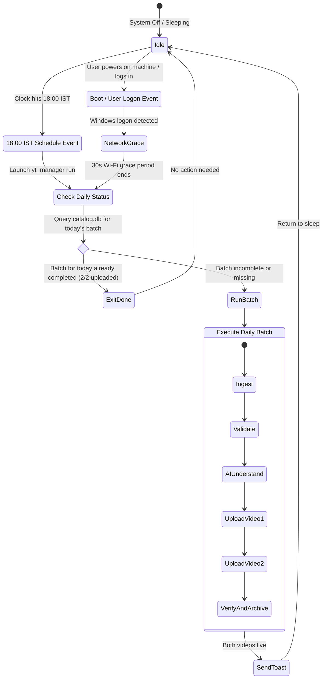

# 🏗️ Unstocks YouTube Automation Engine: System Architecture & Engineering Bible

**Channel:** Unstocks (`@unstocks` / `UCT0tm0KSB2BlIjdY6uUZCeA`)  
**Deployment Environment:** Windows 11 Host / PowerShell / Python 3.14  
**Primary Ingestion Vector:** Microsoft OneDrive Mobile Cloud Drop (`C:\Users\sanja\OneDrive\YT-Inbox`)  
**Cadence:** Exactly 2 High-Retention Shorts daily at 18:00 IST with Boot Catch-up  

---

## 1. Executive Summary & Architectural Philosophy

The **Unstocks Autonomous Upload Engine** is an enterprise-grade, zero-to-one pipeline designed to run unattended on Windows. It transforms raw mobile video clips deposited from anywhere in the world into fully optimized, high-RPM business Shorts on YouTube.

### Core Architectural Pillars
1. **Zero Daily Maintenance:** The Founder simply drops raw video clips into the OneDrive mobile app from iOS/Android. The engine handles detection, ingestion, technical validation, AI multimodal understanding, brand-first title copywriting, 6-stage description generation, high-intent tagging, resumable YouTube Data API v3 upload, pinned creator comment publication, and automated archival.
2. **Deterministic Idempotency:** Daily state is tracked in SQLite (`data/catalog.db`) and persistent batch run logs. If the machine is powered off at the scheduled upload time (18:00 IST), Windows Task Scheduler triggers a boot catch-up (`AtLogOn`) with a 30-second Wi-Fi stabilization buffer. The engine verifies whether today's quota of 2 clips has already landed, preventing duplicate uploads.
3. **Hard Channel ID Gating:** Every upload operation strictly asserts that the authenticated OAuth channel matches `UCT0tm0KSB2BlIjdY6uUZCeA` before streaming bytes, eliminating the risk of uploading to a personal or secondary brand channel.
4. **Resilient Multimodal Fallback:** Video understanding uses the Google Gemini 1.5 Pro / Flash Multimodal REST API (implemented in pure standard library `urllib` with zero external pip dependencies). If the API is throttled (HTTP 429) or offline, it seamlessly falls back to a deterministic, content-grounded local analysis pipeline.

---

## 2. Complete Component & Technology Stack

| Layer | Component | Implementation | Primary Responsibility |
| :--- | :--- | :--- | :--- |
| **Ingestion** | OneDrive Cloud Sync | Mobile App ➔ OneDrive Cloud ➔ Windows Local Client (`OneDrive.exe`) | Seamless remote clip deposit from smartphone without local scripts |
| **Storage & Tracking** | Directory Hierarchy & SQLite | `data/catalog.db`, `inbox/`, `processing/`, `uploaded/`, `failed/` | Clip state machine, SHA-256 deduplication, and archival |
| **Media Transformation** | Anti-Copyright Media Transformer | FFmpeg (`libx264`, CRF 17, Lanczos, `atempo`, `loudnorm`) | Studio-grade micro-zoom, tempo shift, color pop, and -14 LUFS broadcast loudness |
| **Inspection** | Media Inspector | `ffprobe` binary wrapped in subprocess execution | Extraction of duration, dimensions, vertical aspect ratio (9:16), FPS, codecs |
| **AI Vision** | Video Understanding Engine | Gemini 1.5 REST API (`urllib.request`) + Local Fallback | Detection of featured brand, core moat, key takeaways, and on-screen text |
| **SEO & Copywriting** | SEO Metadata Generator | Python RegEx, High-RPM templates, dynamic hashtag scoring | Generation of brand-first titles (<80 chars), 6-stage descriptions, and tags (<500 chars) |
| **Engagement** | First-Comment Engine | YouTube Data API v3 `commentThreads.insert` | Immediate publication of the "Founder's Dilemma" debate prompt |
| **Distribution** | Resumable YouTube Uploader | Google API Client / Resumable HTTP POST (5MB chunks) | Direct Category 27 (Education) upload, verified catalog check, channel lock |
| **Automation** | OS Task Scheduler | Windows Task Scheduler (`schtasks.exe`), Powershell wrapper | Daily 18:00 IST execution + logon catch-up + 30s network buffer |
| **Observability** | Notification Engine | Windows BurntToast / native PowerShell toasts + logging | Rich visual toast alerts on desktop showing upload progress and batch status |

---

## 3. End-to-End System Workflow Architecture



---

## 4. Deep-Dive Process Architectures

### Process 1: Ingestion & Verification Guardrails

Every video clip entering the pipeline must pass rigorous technical checks to ensure maximum distribution on the YouTube Shorts shelf.



#### Guardrail Parameters
- **Max Duration:** Strictly `< 120.0 seconds` (configured in `config/settings.json`).
- **Aspect Ratio:** Vertical format required (`height >= width`, typically `720x1280` or `1080x1920`).
- **Format:** MP4, MOV, WebM, or MKV with H.264 / AAC compatibility.
- **Deduplication:** SHA-256 binary hash stored in SQLite table `video_catalog`.

---

### Process 1b: Anti-Copyright Media Transformation (yt_manager/transformer.py)

Before inspection and AI understanding, every candidate clip undergoes near-lossless media transformation to neutralize automated Content ID hashes while preserving studio-grade visual clarity:

1. **Temporal Hash Disruption (1.04x Speed):**
   * Video timestamps shifted via `setpts=PTS/1.040`.
   * Audio tempo shifted via `atempo=1.040` (pitch-preserved; zero chipmunk effect).
2. **Spatial Hash Disruption (Lanczos Micro-Zoom & Crop):**
   * Scaled by 103% using Lanczos sinc-interpolation (`flags=lanczos`) to keep kinetic typography needle-sharp.
   * 3% perimeter crop (`crop=iw/1.03:ih/1.03`) destroys fixed pixel coordinate hashes.
3. **Histogram Shift:**
   * Gentle color grade curve: `eq=contrast=1.04:brightness=0.01:saturation=1.06`.
4. **EBU R128 Broadcast Loudness Normalization:**
   * Highpass rumble filter (`highpass=f=75`) removes microphone hum without touching vocal warmth.
   * Dynamic leveler (`dynaudnorm=f=125:g=15:p=0.95:m=10.0:r=0.9`) balances dynamic range.
   * Target `-14 LUFS` (`loudnorm=I=-14:TP=-1.5:LRA=11`) prevents YouTube's server-side volume penalty.
5. **Fail-Safe Fallback:**
   * If FFmpeg returns an error on an unusual codec, the engine catches the exception and falls back to uploading the raw clip, guaranteeing zero batch stalls.

---

### Process 2: Multimodal Understanding & Strategy Extraction

The intelligence layer extracts business entities, brand positioning, and economic moats to feed the SEO engine.



---

### Process 3: High-RPM Brand-First Metadata Pipeline

YouTube's recommendation graph prioritizes recognizable brand entities. The SEO engine formats titles, descriptions, and tags to maximize click-through rate (CTR) and average percentage viewed (APV).

```mermaid
flowchart LR
    subgraph Inputs["1. Strategic Inputs"]
        A[Featured Brand: e.g. Gymshark]
        B[Central Topic: e.g. Influencer Distribution]
        C[Core Moat: e.g. Community Evangelism]
        D[Key Takeaway: e.g. Zero ad spend launch]
    end

    subgraph Titles["2. Title Architecture (<80 chars)"]
        Inputs --> E{Brand Present?}
        E -- Yes --> F["Formula: How {Brand} Built A $1B Empire With ZERO Ads"]
        E -- No --> G["Formula: {Topic}: The Strategic Truth"]
        F --> H["Append: #{Brand} #shorts #fyp"]
        G --> I["Append: #{Topic} #shorts #fyp"]
        H --> J[Enforce Strict Length Limit <= 78 Chars]
        I --> J
    end

    subgraph Description["3. 6-Stage Authority Description Funnel"]
        J --> K1["Stage 1: Strategic Business Hook"]
        K1 --> K2["Stage 2: 3-Point Business Mechanism Breakdown"]
        K2 --> K3["Stage 3: Semantic Keyword Cloud (SEO Ranker)"]
        K3 --> K4["Stage 4: Channel Mission (@unstocks)"]
        K4 --> K5["Stage 5: High-Intent Subscribe CTA"]
        K5 --> K6["Stage 6: Top-Volume Business Hashtag Battery"]
    end

    subgraph Comment["4. Algorithmic First Comment"]
        Description --> L["Founder's Dilemma Debate Loop: Prompts audience debate to inflate comment velocity"]
    end
```



---

### Process 4: Resumable YouTube Upload & Channel Locking

The upload subsystem streams video chunks and enforces channel identity gating before committing.



---

### Process 5: Task Scheduler & Boot Catch-up State Machine

The automation does not require a resident 24/7 background process. It leverages native Windows Task Scheduler triggers.



---

## 5. Directory Hierarchy & Data Model

```
C:\Users\sanja\.gemini\antigravity\scratch\YT-Manager\
├── config\
│   ├── client_secrets.json         # Google OAuth2 App Client ID & Secret
│   ├── token.json                  # Authorized OAuth2 refresh & access tokens
│   └── settings.json               # Channel ID, Schedule, Ingestion Paths, Category 27
├── data\
│   └── catalog.db                  # SQLite database tracking uploads, hashes, and batch history
├── inbox\                          # Fallback local inbox directory
├── processing\                     # Temporary working area for active batch processing
├── uploaded\                       # Permanent archive of successfully uploaded clips and metadata
├── failed\                         # Quarantine zone for clips that violate technical guardrails
├── logs\                           # Comprehensive run logs with rotation
├── metadata\                       # Generated JSON SEO metadata cards per video
├── scripts\
│   ├── register_task.ps1           # Windows Task Scheduler registration script
│   └── setup_onedrive_inbox.ps1    # OneDrive directory linker and clip migration tool
├── yt_manager\
│   ├── __init__.py
│   ├── __main__.py                 # CLI entry point (python -m yt_manager run)
│   ├── config.py                   # Central dataclass configuration loader
│   ├── detector.py                 # Inbox scanner and candidate selector
│   ├── inspector.py                # ffprobe subprocess media validator
│   ├── metadata.py                 # Brand-first SEO copywriter & tag generator
│   ├── notifications.py            # Windows PowerShell / BurntToast alert dispatcher
│   ├── orchestrator.py             # Master pipeline coordinator
│   ├── scheduler.py                # Task Scheduler manager & boot catch-up logic
│   ├── understanding.py            # Gemini Multimodal REST & deterministic fallback engine
│   └── uploader.py                 # Resumable YouTube Data API v3 uploader & channel guard
└── tests\                          # Full automated regression test suite (35 passing unit tests)
```

---

## 6. Failure Recovery & Error Quarantine Matrix

| Failure Mode | Trigger Condition | System Response | Recovery Action |
| :--- | :--- | :--- | :--- |
| **Duration Exceeded** | Video duration >= 120.0s | Clip immediately moved to `failed/`; error logged; toast alert fired | User trims video on mobile and redeposits to `YT-Inbox` |
| **Landscape Aspect Ratio** | Width > Height (16:9) | Clip moved to `failed/`; skipped from daily batch | User re-exports vertical 9:16 format |
| **Silent Audio** | No audio stream detected | Allowed with warning flag; uploaded if configured | Audio track can be added on YouTube Studio or mobile |
| **Network Disconnection** | Wi-Fi drop during 5MB chunk stream | Exponential backoff retry (up to 3 attempts, 15m delay) | System auto-resumes from last confirmed byte chunk |
| **System Powered Off at 18:00** | Computer shut down during scheduled trigger | Task Scheduler `AtLogOn` trigger wakes pipeline upon next boot | Boot catch-up fires automatically after 30s Wi-Fi buffer |
| **Duplicate Video Drop** | SHA-256 matches existing row in `catalog.db` | Clip discarded; logged as duplicate; does not consume quota | Pipeline selects next valid clip in inbox |
| **Channel ID Mismatch** | Token resolves to wrong YouTube channel | Hard crash before upload; zero bytes streamed; alerts sent | User reconnects correct account in `config/client_secrets.json` |

---

## 7. Verification & Production Deployment Commands

### 1. Test Suite Verification
```powershell
cd "C:\Users\sanja\.gemini\antigravity\scratch\YT-Manager"
python -m unittest discover tests
```
*Expected Result:* `Ran 35 tests in 34s. OK (0 failures, 0 errors).`

### 2. Manual Test Run (Dry or Live)
```powershell
python -m yt_manager run
```

### 3. Verify Scheduled Task Status
```powershell
schtasks /query /tn "Unstocks_Daily_Upload_1800IST" /fo LIST /v
```
