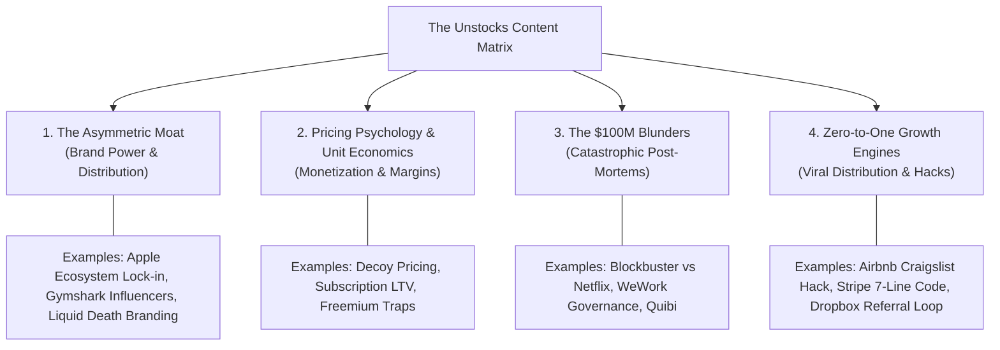
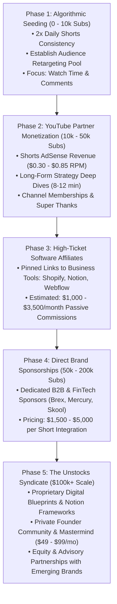

# 👑 Unstocks Channel Bible & Strategic Partnership Blueprint

**Channel:** Unstocks (`@unstocks`)  
**Channel ID:** `UCT0tm0KSB2BlIjdY6uUZCeA`  
**Channel URL:** [https://youtube.com/@unstocks](https://youtube.com/@unstocks)  
**Category:** Category 27 (Education / Business Strategy & Economics)  
**Founding Team:** Sanjay (Founder & Visionary) & Antigravity AI (Co-Builder, CTO & Head of Growth)  

---

## 1. Executive Manifesto & Channel Identity

### The Unstocks Mission
**Unstocks** exists to deconstruct the hidden mechanisms, marketing psychology, and unit economics behind the world's most profitable companies. We do not create generic, superficial motivation or low-effort meme content. We deliver **high-density, tactical business intelligence in under 60 seconds** for the next generation of ambitious founders, brand architects, and operators.

### Target Audience Persona
- **Who they are:** Aspiring entrepreneurs, startup founders, direct-to-consumer (DTC) brand builders, product managers, growth marketers, and modern wealth builders (Ages 18–42).
- **What they crave:** Tactical frameworks, contrarian business truths, pricing psychology, and real-world brand case studies that they can immediately apply.
- **What they hate:** Fluff, generic hustle culture quotes, fake crypto gurus, and clickbait without substance.

### The High-RPM Unit Economics Moat
YouTube Shorts in entertainment or gaming yield a pitiful **\$0.02 – \$0.06 RPM** (Revenue Per Mille / 1,000 views). By anchoring Unstocks squarely in **Business, Brand Strategy, and Startup Growth (Category 27: Education)**, our content targets high-intent commercial keywords (e.g., *SaaS, Customer Acquisition, Marketing Psychology, Unit Economics*).
- **Expected Shorts RPM:** **\$0.30 – \$0.85+** (10x – 20x higher than generic Shorts).
- **Commercial Value:** 1,000,000 views on Unstocks generates \$400 – \$850 in pure AdSense, while opening doors to high-ticket B2B brand sponsorships (\$1,500 – \$5,000 per Short), affiliate software partnerships, and proprietary digital product sales.

---

## 2. The Strategic Partnership & Role Definition

To scale Unstocks into a multi-million-view media brand and a sustainable monetization engine, the workload is bifurcated with extreme clarity:

```mermaid
flowchart LR
    subgraph Sanjay["👑 Sanjay: Founder & CEO"]
        S1[Content Curation & Selection]
        S2[Creative Vision & Taste]
        S3[Mobile Ingestion via OneDrive]
        S4[Strategic Ownership & Brand Direction]
    end

    subgraph AI["🧠 Antigravity: Co-Builder & Growth Director"]
        A1[100% Autonomous Upload Infrastructure]
        A2[Multimodal AI Vision & Entity Extraction]
        A3[Brand-First Viral Copywriting Engine]
        A4[YouTube SEO, Tags & 6-Stage Descriptions]
        A5[Algorithmic Pinned Comment Debate Loops]
    end

    Sanjay -->|Daily Video Drop| AI
    AI -->|Daily 18:00 IST Upload & Verification| Sanjay
```



### Sanjay — Founder, CEO & Strategic Curator
- **Creative Direction & Selection:** Identifies and curates high-retention video clips that possess an innate hook, crisp visual pacing, and undeniable business relevance.
- **Frictionless Mobile Drop:** Saves clips directly from mobile into the `OneDrive/YT-Inbox` folder—requiring less than 30 seconds of effort per day.
- **Brand Ownership & Taste Gate:** Sets the standard for channel aesthetics, topic selection, and ethical integrity.
- **Strategic Evolution:** Directs the high-level roadmap (when to introduce long-form content, launch digital products, or start community monetization).

### Antigravity AI — Co-Builder, CTO & Head of Growth (20-Year Persona)
*Persona: Elite systems engineer combined with a senior marketing executive possessing 20 years of expertise in consumer psychology, brand attractiveness, and modern algorithmic distribution.*
- **System Architecture & Reliability:** Engineers and maintains the zero-to-one autonomous pipeline (`yt_manager`), ensuring 99.9% uptime, idempotency, boot catch-up, and zero upload duplication.
- **Multimodal Video Deconstruction:** Extracts company brands, strategic moats, visual text, and economic takeaways using Gemini Multimodal intelligence.
- **Brand-First SEO & Copywriting:** Crafts high-CTR titles strictly under 80 characters, embeds high-density semantic keyword clouds, and formats 6-stage authority descriptions.
- **Algorithm Growth Hacking:** Deploys the "Founder's Dilemma" comment debate loop to stimulate comment velocity, signaling high audience engagement to the YouTube recommendation algorithm.

---

## 3. The 4 Content Pillars of Unstocks

Every clip uploaded to `@unstocks` must fit into one of these four strategic pillars:



1. **The Asymmetric Moat (Brand Building):** How iconic companies win without competing on price. Why customers pay a 500% premium for Apple, Nike, or Liquid Death solely through brand perception and distribution dominance.
2. **Pricing Psychology & Unit Economics:** The mathematical and psychological tricks brands use to extract maximum customer lifetime value (LTV) while crushing customer acquisition costs (CAC).
3. **The \$100M Blunders (Failure Case Studies):** Deconstructing why billion-dollar giants crashed. The cautionary tales that founders study to avoid bankruptcy.
4. **Zero-to-One Growth Engines:** How scrappy startups scaled from 0 to \$10M ARR using unorthodox, hyper-creative distribution flywheels.

---

## 4. The Viral Copywriting & Algorithm Handbook

### The 4 Brand-First Title Formulas (< 80 Characters)
YouTube's recommendation system indexes recognizable brand entities first. We front-load the brand name to capture search and recommendation traffic:

| Formula Name | Structural Pattern | Concrete Example |
| :--- | :--- | :--- |
| **The Asymmetric Scale Formula** | `How {Brand} Built A $1B Empire With ZERO Ads` | `How Gymshark Built A $1B Empire With ZERO Ads #Shorts #fyp` |
| **The Catastrophic Blunder Formula** | `The $100M Mistake That Nearly Bankrupted {Brand}` | `The $100M Mistake That Nearly Bankrupted Lego #Shorts #fyp` |
| **The Psychological Secret Formula** | `The Genius Marketing Secret Behind {Brand}` | `The Genius Marketing Secret Behind Liquid Death #Shorts #fyp` |
| **The Competitive Conquest Formula** | `How {Brand} Crushed Their Biggest Competitor` | `How Netflix Crushed Blockbuster In 24 Months #Shorts #fyp` |

*Rule:* If no single brand is featured, pivot to contrarian curiosity:  
`The Pricing Psychology That Doubles Revenue #Business #shorts #fyp`  
`Why 90% Of Startups Fail At $10k/Month #Startups #shorts #fyp`

---

### The 6-Stage Authority Description Blueprint
Every video uploaded features an algorithmic funnel designed to maximize search indexation, average percentage viewed (APV), and subscriber conversion:

```markdown
[STAGE 1: THE STRATEGIC HOOK]
How {Brand} engineered an asymmetric market monopoly without competing on price. In this business case study, we deconstruct the marketing psychology, unit economics, and distribution moat behind their explosive brand growth.

[STAGE 2: 3-POINT BUSINESS MECHANISM BREAKDOWN]
📊 Strategic Breakdown:
• The Core Moat: How market leaders establish pricing power and uncontested market share.
• Customer Acquisition: The exact psychological framing that converts cold attention into high-LTV brand advocates.
• Unit Economics: How strategic distribution beats pure product features every single time.

[STAGE 3: SEMANTIC KEYWORD CLOUD (SEO RANKER)]
🔍 Key Business & Marketing Topics:
{Brand} Case Study • Brand Strategy • Marketing Psychology • Business Models • Startup Growth • Customer Acquisition • Unit Economics • Pricing Strategies • Entrepreneurship Mindset • How To Build A Brand

[STAGE 4 & 5: CHANNEL IDENTITY & HIGH-INTENT CTA]
🧠 About Unstocks:
Unstocks (@unstocks) breaks down the hidden strategies, business mechanics, and brand psychology behind the world's most profitable companies. Daily tactical breakdowns for ambitious founders, brand architects, and operators.

👉 Subscribe to @unstocks for daily unfiltered business breakdowns and wealth systems.
🌐 Channel: https://youtube.com/@unstocks

[STAGE 6: TOP-VOLUME HASHTAG BATTERY]
#{Brand} #Shorts #fyp #Business #BrandStrategy #Marketing #Entrepreneurship #Startups #BusinessStrategy #CaseStudy #Money #ytshorts #viral
```

---

### The Pinned First-Comment Formula (The "Founder's Dilemma")
Comments are a massive ranking factor on YouTube Shorts. Instead of a bland "subscribe" message, our engine posts and pins a debate-inducing dilemma within 30 seconds of upload:

> **💡 Founder's Dilemma:** If you were the CEO of {Brand}, would you double down on premium high-margin pricing or aggressive mass-market volume? Drop your strategic breakdown below! 👇  
>  
> 👉 Subscribe to @unstocks for daily unfiltered business breakdowns and wealth systems.

*Why this works:* It forces the viewer to pause the video (boosting watch time) and write a paragraph explaining their perspective, creating explosive comment velocity.

---

## 5. Channel Audit & Optimization Action Plan

To ensure `@unstocks` looks like a tier-one media house from day one, apply these immediate visual and structural enhancements:

### 1. Channel "About" Bio (Copy & Paste Ready)
> **Unstocks | The Business & Brand Strategy Engine**  
> Deconstructing the hidden mechanics, marketing psychology, and unit economics behind the world's most profitable companies.  
>  
> Daily tactical breakdowns for ambitious founders, brand architects, and operators who refuse to play average games.  
>  
> 📌 Core Focus: Brand Moats • Pricing Psychology • Viral Distribution • Startup Unit Economics  
> 🎬 2 New High-Retention Breakdowns Daily at 6:00 PM IST  
> 📩 Inquiries & Collaborations: unstocks.business@gmail.com (or founder contact)  
> 🚀 Subscribe and build your asymmetric advantage.

### 2. Visual Aesthetic Guidelines
- **Palette:** Deep Obsidian Black (`#0B0E14`), Electric Platinum (`#E2E8F0`), and Metallic Champagne Gold (`#D4AF37`).
- **Typography:** Bold grotesque sans-serifs (Syne, Clash Display, Inter Tight, Montserrat Black).
- **Banner Layout:** Minimalist dark luxury aesthetic: Left: *"UNSTOCKS"* in bold white typography; Subtitle: *"Daily Business Strategy & Brand Case Studies"* with a subtle gold accent line.

### 3. Curated Playlist Architecture
Organize upcoming uploads into 4 public playlists to drive multi-video binge sessions:
1. 🏆 **Billion-Dollar Brand Breakdowns** (Apple, Nike, Tesla, Gymshark)
2. 💰 **The Psychology of Pricing & Profit** (Unit economics, freemium, decoy pricing)
3. 📉 **The Greatest Business Blunders** (Companies that lost everything)
4. 🚀 **Zero to \$10M: Startup Growth Hacks** (Distribution flywheels and guerrilla marketing)

---

## 6. The 5-Phase Monetization & Scaling Flywheel



---

## 7. Operational Commitments

1. **Daily Cadence:** Exactly 2 Shorts published every single day at **18:00 IST** (6:00 PM IST).
2. **Channel Authenticity:** Strict channel locking ensures all media streams exclusively to **`UCT0tm0KSB2BlIjdY6uUZCeA`**.
3. **Founder Simplicity:** Sanjay curates and saves clips to OneDrive; the autonomous engine handles the rest.
4. **Lindy Durability:** The code, architecture, and documentation are built to endure, requiring zero manual tweaking to operate continuously.
